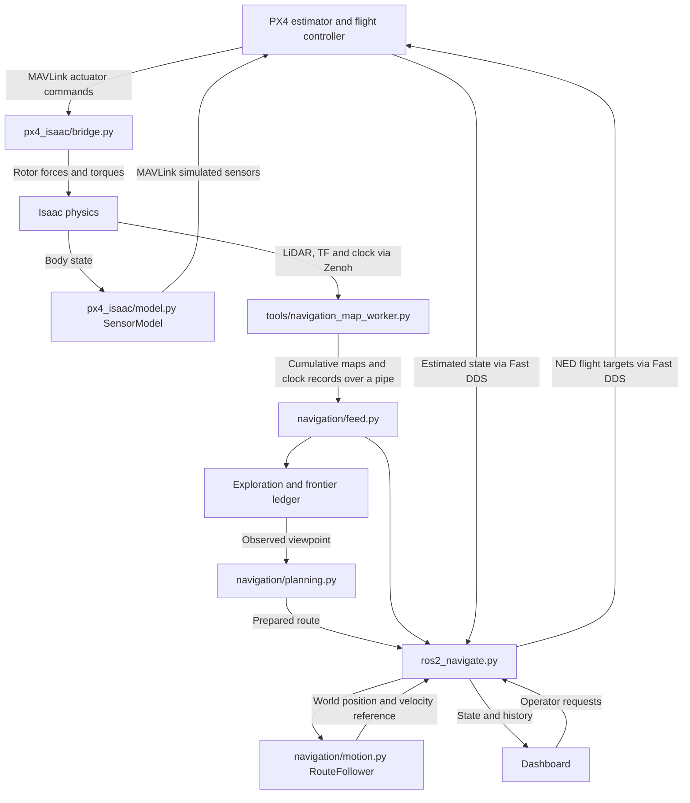

# Isaac / PX4 drone — code walkthrough

This guide explains each project file's responsibilities, the most important
functions inside it, and how the parts connect. [README.md](README.md) covers
setup, launching and operation. The previous mentoring notes and incident
analyses are preserved in [teaching history](docs/history/TEACHING_NOTES_2026-10-19.md).

## 1. System flow

The project has two connected loops. The physics loop turns PX4 motor commands
into simulated motion and returns simulated sensor measurements. The navigation
loop turns LiDAR observations and PX4 state into flight targets. PX4 performs
state estimation and motor control.

Three distinctions help when reading the code:

- **Map, route, reference, motion:** the map describes observations; the route
  describes where to go; the reference describes desired motion now; PX4 and
  Isaac determine the resulting physical motion.
- **Coordinates:** mapping and planning use Isaac world XY; PX4 targets use
  local NED. `FrameAlignment` converts positions, velocities and yaw. Grid indices
  are `(row, column)`; world positions are `(x, y)` in metres.
- **Clocks:** simulation time advances trajectories. Host monotonic time checks
  receipt delays and watchdogs. Capture timestamps select sensor transforms and
  align diagnostic measurements.

## 2. Entry points and flight coordination

### [ros2_navigate.py](ros2_navigate.py) — navigation coordinator

Owns the live `GoalNavigator` ROS node. Connects telemetry, maps, operator
requests, background planning, exploration and motion. Algorithms live in
`navigation/`; this file decides when and how to use their results.

Read these methods first:

- `GoalNavigator.__init__()` creates subscriptions, publishers, workers and state.
- `on_position()` and `on_status()` receive PX4 state. `status_fresh()` and
  `flight_active()` check whether that state permits navigation.
- `capture_alignment()` establishes world/PX4 alignment and the experiment home
  point after stable mapped hover. `map_pose_matches()` checks the map against
  PX4 position history near cloud receipt time.
- `commands_tick()` consumes requests and handles goals/cancellation. `stop()`
  moves the controller into a hold, pause or other stopped phase.
- `launch_plan()` prepares routes in a worker; `launch_frontier()` selects
  exploration work. `launch_reconsideration()` and `reconsideration_tick()`
  evaluate updated maps while travel continues and apply valid results.
- `publish_target()` is the main control callback: check state and clocks,
  consume planning results, validate the remaining route, advance the follower,
  convert the reference to NED and publish PX4 targets.
- `update_yaw()` coordinates heading. `exploration_tick()` and `mission_tick()`
  advance exploration and the explore/save/land lifecycle.
- `update_dashboard()` assembles status; `publish_reports()` performs background
  visualization/file output; `flight_readiness()` explains available flight actions.
- `main()` runs the application and manages the reset/reload lifecycle.

Planning jobs carry generation tokens so old results cannot replace newer goals.
Workers prepare results; the controller applies them.

### [ros2_hover.py](ros2_hover.py) — fixed hover target

A smaller publisher for studying PX4 targets before mapped navigation. Provides
state helpers reused by the other publishers.

- `hover_messages()` constructs Offboard and trajectory messages.
- `HoverState.observe()` validates local position and detects origin resets;
  `fresh()` and `motion_ready()` expose freshness and usability.
- `HoverPublisher.on_position()` receives state; `publish_target()` streams the
  fixed reference when allowed. `main()` runs the publisher or message check.

### [ros2_step.py](ros2_step.py) — one bounded forward movement

Captures a heading and executes one operator-triggered step with a smooth
reference and live clearance checks. It does not arm or select a flight mode.

- `step_duration()` chooses a duration from distance, speed and acceleration.
- `StepPlan.start()`, `advance()` and `hold()` manage the reference;
  `displacement()` measures forward and sideways travel.
- `SimulationPacer.observe()` accumulates accepted IMU integration periods;
  `fresh()` checks progress. The navigator reuses it for readiness checks.
- `StepPublisher.handle_commands()`, `clearance_check()` and `publish_target()`
  connect operator input, clearance and target publication.
- `preview()` prints a prospective endpoint without creating flight publishers.

## 3. Perception and mapping

### [lidar_tools/cloud.py](lidar_tools/cloud.py) — point-cloud decoding

`xyz_array()` converts `PointCloud2` messages into XYZ NumPy arrays while
respecting field offsets, row padding and byte order. `cloud_summary()` reports
finite returns and range statistics.

### [lidar_tools/clearance.py](lidar_tools/clearance.py) — obstacle measurements

`ClearanceLimits` validates measurement limits. `estimate_flat_floor()` estimates
a broad floor plane. `forward_surfaces()` transforms returns, removes low floor
points and selects surfaces in a body-forward corridor. `health_issue()` checks
scan/clock timing before an observation is accepted.

### [tools/forward_clearance.py](tools/forward_clearance.py) — ROS perception worker

`ForwardClearance` subscribes to LiDAR/clock and uses capture-time TF. Reports
clearance and visualization without flight-control publishers. The map worker
extends this class.

- `on_cloud()` accepts pending input; `on_clock()` tracks simulation time.
- `process_pending()` resolves capture-time transforms and computes clearance.
- `snapshot()` builds reports; `publish_status()` and `markers()` expose results.
- `stamp_ns()` and `transform_parts()` decode timestamps and transforms.

### [tools/navigation_map_worker.py](tools/navigation_map_worker.py) — map acquisition

Runs on the Isaac/Zenoh side and sends JSON records over stdout. Owns the
accumulating `RayMap`, so each published map contains earlier accepted observations.

- `MapWorker.make_map()` creates the configured grid.
- `on_clock()` emits small clock records and clears mapping on clock reset.
- `process_pending()` checks timing, capture-time TF, bounds and hover height,
  then integrates the cloud with `RayMap.update()`.
- `publish_status()` serializes the grid, wall evidence, pose, hits and health.
  `main()` configures and runs the worker.

### [navigation/mapping.py](navigation/mapping.py) — occupancy-grid algorithm

Independent of ROS. Cell labels are `UNKNOWN`, `FREE`, `OCCUPIED` and `START_AREA`.
The last label represents an explicitly assumed vehicle footprint.

- `RayMap.cell()`, `world()` and `inside()` convert coordinates and check bounds.
- `RayMap.update()` selects fixed-height rays, clears observed free segments,
  marks obstacle hits and accumulates wall-confirmation evidence. Unseen space
  and space behind hits stay unknown.
- `RayMap.geometry()` derives wall clearance, the body-free mask and the
  preferred-clearance safe mask.
- `RayMap.wall_policy()` reports tentative/persistent wall evidence.
- `distance_field()` computes distances for footprint and clearance checks.

A first hit blocks planning immediately; confirmation makes a wall persist until reset.

### [navigation/feed.py](navigation/feed.py) — validated map snapshots

Owns the mapping subprocess and its boundary with the navigator.

- `MapSnapshot` packages geometry, masks, pose, hits and timestamps. `fresh()`
  checks validity/age; `health()` produces its diagnostic report.
- `MapFeed._read()` validates pipe records and immediately ingests clock records.
- `_enqueue_map()` and `_process_maps()` run geometry on a separate thread,
  retaining only the newest waiting cumulative map.
- `_process_map()` validates geometry/wall evidence and builds or reuses masks.
- `_fail()` revokes readiness after failure/EOF; `get()` returns the current
  snapshot; `close()` shuts down the worker and threads.

### [lidar_tools/flight_gate.py](lidar_tools/flight_gate.py) — clearance permission

`ClearanceGate.observe()` validates clearance envelopes. `decision()` returns a
`GateDecision` describing whether the bounded step experiment has usable fresh
clearance; `invalidate()` revokes it. Repeated reports cannot refresh an old scan.

### [lidar_tools/clearance_feed.py](lidar_tools/clearance_feed.py) — clearance adapter

`ClearanceFeed` starts the perception-only subprocess, reads its output in
`_read()`, exposes the gate through `decision()` and releases it with `close()`.
It is the clearance counterpart to mapped navigation's `MapFeed`.

## 4. Route planning and motion

### [navigation/centering.py](navigation/centering.py) — route preferences

`center_geometry()` derives clearance and center ridges inside known space.
`routing_geometry()` constructs traversal costs penalizing low clearance and
distance from those ridges. These preferences favor central, wider routes;
unknown space remains excluded by the hard masks.

### [navigation/planning.py](navigation/planning.py) — geometric routes

- `plan(snapshot, start_xy, goal_xy)` validates a destination, searches, shortcuts
  while preserving clearance/cost constraints, and rounds safe bends.
- `astar()` searches the safe grid with optional costs and no diagonal corner cutting.
- `escape_start()` conservatively connects a near-wall start to preferred-clearance space.
- `reachable_mask()` finds connected safe space; `route_distances()` measures
  grid travel distances used in frontier candidate generation.
- `line_cells()` and `segment_safe()` check segments; `path_cost()` and
  `segment_cost()` compare weighted route costs.

Returns world-XY waypoints. Weighted planning cost and geometric flight distance
have different meanings.

### [navigation/curves.py](navigation/curves.py) — curves and speed limits

`rounded_route()` replaces eligible corners with sampled quadratic curves only
when an acceptance callback approves them. `corner_limit()` computes local bend
speed limits. `speed_profile()` combines these with a backward braking pass to
slow the reference before bends and the endpoint.

### [navigation/prepared_route.py](navigation/prepared_route.py) — prepared route checks

`PreparedRoute` stores a path, per-segment cell footprints and speed limits
computed in a planning worker.

- `footprint()` includes cells needed to prevent diagonal corner cutting.
- `PreparedRoute.with_start()` updates the initial connector and affected limits.
- `PreparedRoute.safe()` checks precomputed cells against a current snapshot.
- `route_safe()` supports prepared and ordinary paths; `remaining_safe()` checks
  the remaining route or the reserved stopping envelope during braking.

### [navigation/motion.py](navigation/motion.py) — flight references

Turns geometric paths into time-dependent position/velocity references, with no
ROS or Isaac API calls.

- `FrameAlignment.world()` and `ned()` convert positions. `world_velocity()` and
  `ned_velocity()` rotate velocities without a position offset. `yaw_ned()`
  converts a route heading to PX4 yaw.
- `RouteFollower.begin()` starts a route; `retarget()` handles an update;
  `hold()` fixes a stopped reference.
- `RouteFollower.tick()` advances by simulated elapsed time using speed,
  acceleration, tracking, heading and obstacle constraints.
- `braking_tick()` advances a reserved stopping maneuver and signals when the
  coordinator should replan to the retained goal.
- `remaining_path()` and `heading_direction()` expose geometry for checks and yaw.
- `braking_speed()` reserves reaction travel and stopping distance;
  `clearance_ahead()` measures obstacles in the motion direction; `smooth_yaw()`
  bounds yaw rate/acceleration. `approach_speed()` supplies a distance-band speed rule.

### [navigation/braking.py](navigation/braking.py) — stopping-space geometry

`stopping_envelope()` reserves stopping rays for commanded and measured velocity,
including reaction allowance. `swept_space_safe()` checks the entire convex area
between them against the current body-free mask. It checks the interior as well
as boundaries; unknown/out-of-map space cannot certify a stop. This is a spatial
planning model, not a measurement of PX4's physical braking performance.

### [navigation/timing.py](navigation/timing.py) — trajectory clock

`TrajectoryClock.observe()` accepts Isaac clock samples. `consume()` returns
usable elapsed simulation time; `fresh()` checks progress; `invalidate()` revokes
the clock; `report()` exposes state. These guards handle pauses, resets and
unsuitable jumps before a reference advances.

## 5. Exploration and missions

### [navigation/exploration.py](navigation/exploration.py) — choose the next observation

- `frontiers()` finds free cells adjacent to unknown cells.
- `visible_unknown_cells()` and `visible_unknown()` estimate potential new
  observations, stopping rays at mapped obstacles.
- `wall_endings()` detects confirmed-wall ending clues; `wall_occluded_cells()`
  checks proposed unknown cells hidden behind known walls.
- `choose_frontier()` evaluates reachable observed viewpoints and compares
  planned flight-route lengths, returning an `ExplorationChoice`.
- `ExplorationSession.start()`, `observe()` and `record_pose()` manage sessions,
  progress and travel history. `arrived()` and `scanned()` distinguish arrival
  from new scan evidence. `pause()` and `cancel()` handle interruptions.

Targets stay in observed navigable space. Information estimates explain
viewpoint usefulness without adding predicted geometry to the map.

### [navigation/frontier_ledger.py](navigation/frontier_ledger.py) — frontier memory

`components()` groups boundary cells; `boundary_geometry()` measures their
principal-axis extent. `FrontierLedger.update()` matches boundaries across scans,
including splits, merges and disappearance evidence. `apply_choice()` records
selection outcomes; `snapshot()` supplies a catalog; `report()` supplies UI/history data.

Frontier identity survives route changes. A visited viewpoint does not itself
resolve a boundary; filtering small boundaries leaves unresolved work.

### [navigation/async_frontiers.py](navigation/async_frontiers.py) — background analysis

`AsyncFrontiers` keeps ledger mutation and geometry outside the tracking callback.
`_analyze()` updates the ledger and computes completion evidence; `observe_map()`
submits maps and consumes lifecycle changes. `ready_for()` and `completion_for()`
require a matching map stamp. `apply_choice()` transfers an outcome to the worker;
`snapshot()`/`report()` expose results; `close()` shuts down the worker.

### [navigation/mission.py](navigation/mission.py) — completion, export and landing

- `assess_completion()` returns `CompletionEvidence`: whether the connected
  observed fixed-height component is enclosed without unknown boundaries or map
  edge contact. Sealed rooms and other heights are outside this claim.
- `save_map()` exports raw grid/wall evidence and a ROS-compatible PGM/YAML map.
- `ExploreMission.confirm()` accumulates fresh completion evidence;
  `reset_confirmation()` clears it when conditions change.
- `request_landing()`, `acknowledge_land()`, `landing_due()` and
  `observe_landing()` track requests, acknowledgments and observed completion.
- `start()`, `cancel()`, `incomplete()` and `report()` manage mission lifecycle.

`GoalNavigator` coordinates the map-save job and actual landing publication.

## 6. Dashboard, controls and lifecycle

### [navigation/dashboard.py](navigation/dashboard.py) — local HTTP interface

Serves HTML/JSON, validates requests and queues navigation actions. Explicit
native flight buttons use the attached `FlightControls` service.

- `validate_destination()` checks finite XY coordinates.
- `Dashboard.__init__()` installs HTTP handlers and request protections.
- `plan_destination()` and `plan_home()` produce previews.
- `observe()` receives controller reports; `state()` builds API responses.
- `log_receipt()` and `acknowledge_command()` correlate requests/outcomes;
  `close()` stops the server.

### [config/navigation.html](config/navigation.html) — browser application

Contains HTML, CSS and JavaScript for the map, flight controls, readiness,
frontier work list and history review.

- `poll()` fetches state; `update()` and `renderCockpit()` update the interface.
- `draw()`, `projection()`, `screen()` and `route()` render geometry.
- `sendAction()` and `post()` submit requests; `refreshReceipt()` follows outcomes.
- `previewHome()` requests a return preview. `renderHistory()` and `reviewFrame()`
  display recorded events/maps; `renderFeedback()` displays command feedback.

### [navigation/flight_controls.py](navigation/flight_controls.py) — native PX4 actions

`FlightControls.allowed()` checks fresh readiness; `start()` launches a request;
`run()` dispatches it; `observe()` waits for measured completion. `cancel()`
invalidates pending work. `NativeFlightBackend.verify_simulator()` checks the
intended instance; `execute()` issues bounded takeoff, Offboard, Land or native Hold commands.

### [navigation/reset.py](navigation/reset.py) — experiment restart

`ExperimentReset.start()` launches a job; `run()` sequences Hold, publisher
release, history archiving, simulator/service restart and readiness checks.
`update()`/`report()` expose progress. `ResetBackend` implements operations such
as `hold()`, `stop_scene()`, `load_bridge()`, `play()` and `ground_ready()`.
`local_ground_ready()` validates estimated ground state; `EmptyFeed` represents
the temporary absence of a map worker.

Reset uses scene-authored placement, clears map/home/exploration state and ends
disarmed on the ground while the dashboard remains available.

### [navigation/runtime.py](navigation/runtime.py) — version and reload handoff

`RuntimeVersion.fingerprint()` hashes relevant source/settings; `report()`
exposes version information. `prepare_reload()` saves a history handoff after
successful reset/publisher shutdown; `restore_reload()` restores it after restart.

### [navigation/settings.py](navigation/settings.py) — validated configuration

`NavigationSettings` defines fields; `validate()` checks bounds and relationships;
`map_options()` supplies map-constructor arguments. `load_settings()` reads
[config/navigation_settings.json](config/navigation_settings.json), holding grid,
speed, acceleration, clearance and exploration parameters loaded at startup.

### [navigation/background.py](navigation/background.py) — bounded worker utility

`LatestWorker.submit()` retains one newest pending input while work runs.
`_run()` invokes the handler and captures results/errors; `latest()` retrieves
them; `close()` stops work and prevents late result publication. Frontier
analysis and reporting use it. Threads do not guarantee real-time scheduling.

## 7. History, visualization and diagnostics

### [navigation/history.py](navigation/history.py) — maps, decisions and receipts

`RunHistory.event()` records decisions; `observe()` records state, map frames,
targets and measured travel through a background writer. `report()` returns
history summaries; `frame()` retrieves a map; `flush()`/`close()` drain and stop
recording. `CommandReceipts.begin()` assigns or recognizes requests; `update()`
records progress; `report()` exposes outcomes.

### [navigation/ros_map.py](navigation/ros_map.py) — RViz output

`map_message()` converts snapshots to ROS occupancy data; `pose_message()` builds
a pose. `RosMapPublisher.publish()` publishes map, route and trail on Fast DDS.

### [navigation/diagnostic_wire.py](navigation/diagnostic_wire.py) — passive observations

`DiagnosticEmitter.emit()` sends best-effort localhost observations to the
independent recorder; `close()` releases its socket. Emission failures do not
change flight decisions.

### [navigation/diagnostics.py](navigation/diagnostics.py) — evidence analysis

`parse_listener()` reads native PX4 output. `interpolate()` aligns bracketed
samples without extrapolating across gaps. `world_xy()` converts comparison
positions; `statistics()` summarizes errors; `incident_window()` selects evidence.
`analyze()` compares source times, truth, estimates, references and pauses.
`read_status()` reads recorder status; `finite()` makes values suitable for JSON.
Tracking error, estimator disagreement and observation delay remain separate measurements.

## 8. Isaac physics and the PX4 bridge

### [load_bridge.py](load_bridge.py) — Isaac bootstrap

Top-level code executed inside stopped Isaac: close an existing bridge, load
fresh modules and construct `IsaacPX4Bridge` from [bridge_config.json](bridge_config.json).
Retains the bridge in `builtins` for inspection/shutdown.

### [bridge_loader.py](bridge_loader.py) — fresh source loading

`load_bridge_modules()` compiles local bridge source directly to avoid persistent
Isaac import caches. Restores previous module registrations if loading fails.

### [px4_isaac/bridge.py](px4_isaac/bridge.py) — physics integration

- `IsaacPX4Bridge.__init__()` reads configuration and sets up scene/physics integration.
- `_initialize_view()` prepares the physics view; `_body_state()` reads vehicle state.
- `_pre_step()` receives controls and applies modeled rotor forces/torques.
- `_post_step()` samples the resulting state and sends simulated sensors.
- `_fail()`, `_on_stop()` and `close()` handle failure, timeline stop and cleanup.

### [px4_isaac/model.py](px4_isaac/model.py) — rotor and sensor mathematics

`RotorModel.step()` converts controls to rotor response and body wrench.
`SensorModel.sample()` converts motion to simulated accelerometer, gyroscope,
magnetometer, pressure and GPS-related values in PX4 frames. `rotation_wxyz()`
builds a rotation matrix; `resolve_gravity_direction()` interprets USD gravity defaults.

### [px4_isaac/mass.py](px4_isaac/mass.py) — configured vehicle mass

`normalized_link_masses()` and `configured_link_masses()` calculate/validate the
per-link distribution instead of relying on source-asset density.

### [px4_isaac/transport.py](px4_isaac/transport.py) — MAVLink UDP

`wsl_address()` resolves the simulator address. `SimulatorTransport.receive()`
reads actuators; `fresh()` checks their age; `send_sensor()` emits HIL sensor/GPS
messages; `write()` sends bytes; `close()` releases the socket.

`bridge_config.json` supplies vehicle prim, transport, mass/frame, rotor and
sensor parameters. The `__init__.py` files in `px4_isaac/`, `navigation/` and
`lidar_tools/` identify the packages and contain short package descriptions.

## 9. Supporting tools and launchers

Some tools execute top-level code inside Isaac rather than defining `main()`.

### Connection, services and scene preparation

| File | Responsibility and important functions |
| --- | --- |
| [tools/enable_lab_control.py](tools/enable_lab_control.py) | Bootstrap authenticated local Isaac execution; `record_ready()` stores connection details; `report_failure()` reports bootstrap failure. |
| [tools/isaac_client.py](tools/isaac_client.py) | `execute()` submits authenticated Python; `main()` exposes status, script and source execution. |
| [tools/lab.ps1](tools/lab.ps1) | Start/reuse, inspect and stop named services. `Find-Service()` identifies processes; `Get-Px4Processes()` inspects WSL; `Assert-CanStop()` checks stop prerequisites. |
| [tools/prepare_maze_scene.py](tools/prepare_maze_scene.py) | Prepare stopped-scene maze collisions and remove the old room. |
| [tools/configure_navigation_lidar.py](tools/configure_navigation_lidar.py) | Apply sensor settings for fixed-height mapping. |
| [tools/lock_drone_arms.py](tools/lock_drone_arms.py) | Back up the scene layer and lock folding-arm joint limits. |
| [tools/use_scene_placement.py](tools/use_scene_placement.py) | Back up the session layer and remove a legacy position override. |
| [tools/plan_obstacle.py](tools/plan_obstacle.py) | `main()` calculates stationary test-box placement values without creating the box. |

### Inspection and recording

| File | Responsibility and important functions |
| --- | --- |
| [tools/inspect_scene.py](tools/inspect_scene.py) | Print scene units, bodies, joints and rotor candidates inside Isaac. |
| [tools/inspect_vehicle_runtime.py](tools/inspect_vehicle_runtime.py) | Inspect live chassis pose and arm joints. |
| [tools/inspect_lidar_scene.py](tools/inspect_lidar_scene.py) | `inspect_live()` examines the open sensor graph; `inspect_saved()` inventories a saved layer. |
| [tools/inspect_lidar_runtime.py](tools/inspect_lidar_runtime.py) | `snapshot()` captures runtime graph state; `inspect()` compares snapshots one second apart. |
| [tools/audit_scene_settings.py](tools/audit_scene_settings.py) | Audit scene/sensor settings after restart. |
| [tools/check_usd_gravity.py](tools/check_usd_gravity.py) | Inspect authored gravity and USD defaults offline. |
| [tools/lidar_probe.py](tools/lidar_probe.py) | `LidarProbe.on_cloud()`, `resolve_pending_tf()` and `report()` inspect clouds, TF, clock and optional PX4 position. |
| [tools/px4_state_probe.py](tools/px4_state_probe.py) | `main()` samples PX4 topics; `motion_stats()` summarizes measured movement. |
| [tools/px4_timing_probe.py](tools/px4_timing_probe.py) | WSL `main()` reads native uORB snapshots. |
| [tools/record_timing.py](tools/record_timing.py) | Independent passive recorder; `main()` collects observations; `atomic_json()` writes status/incident metadata. |
| [tools/capture_mapping_input.py](tools/capture_mapping_input.py) | `main()` records raw clouds and capture-time transforms into an NPZ. |

### Offline replay and validation

| File | Responsibility and important functions |
| --- | --- |
| [tools/analyze_timing.py](tools/analyze_timing.py) | CLI `main()` runs recorded timing/incident analysis. |
| [tools/analyze_mapping_input.py](tools/analyze_mapping_input.py) | `analyze()` replays recorded cloud/TF and compares it with audited planar maze walls. |
| [tools/replay_maze_mapping.py](tools/replay_maze_mapping.py) | `ideal_rays()` generates modeled returns; `main()` replays recorded travel to study mapping artifacts. |
| [tools/replay_exploration.py](tools/replay_exploration.py) | `main()` runs an offline occluded-room exploration example. |
| [tools/recover_navigation_history.py](tools/recover_navigation_history.py) | `recover()` reconstructs recorded states/targets without inventing missing historical maps. |
| [tools/headless_validate.py](tools/headless_validate.py) | Run physics checks in a private test scene. |
| [tools/summarize_validation.py](tools/summarize_validation.py) | Summarize PhysX samples with their ROS command evidence. |

### Shell and Windows entry points

| File | Responsibility |
| --- | --- |
| [start-isaac-px4.cmd](start-isaac-px4.cmd) | Windows launcher for WSL PX4 SITL. |
| [px4/start-isaac-sitl.sh](px4/start-isaac-sitl.sh) | Prepare external-simulator startup, DDS/vehicle parameters and launch PX4, optionally as a daemon. |
| [px4/simulator-udp.sh](px4/simulator-udp.sh) | PX4 startup include configuring simulator sensors and MAVLink UDP reception. |
| [tools/ros2_navigate.cmd](tools/ros2_navigate.cmd) | Configure Fast DDS and launch navigation; restart after reset/reload exit code. |
| [tools/ros2_hover.cmd](tools/ros2_hover.cmd) | Configure Fast DDS and launch hover. |
| [tools/ros2_step.cmd](tools/ros2_step.cmd) | Configure Fast DDS and launch bounded steps. |
| [tools/forward_clearance.cmd](tools/forward_clearance.cmd) | Launch clearance on Zenoh with its status output path. |
| [tools/lidar_mount_tf.cmd](tools/lidar_mount_tf.cmd) | Publish the measured chassis-to-LiDAR transform; update when the mount changes. |
| [tools/ros_observe.cmd](tools/ros_observe.cmd) | Select DDS or Zenoh and launch the LiDAR probe. |
| [tools/px4_state_probe.cmd](tools/px4_state_probe.cmd) | Configure DDS and run the PX4 state probe. |
| [tools/rviz_navigation.cmd](tools/rviz_navigation.cmd) | Open RViz with the navigation layout on Fast DDS. |
| [tools/check_all.cmd](tools/check_all.cmd) | Run Python test discovery on an isolated ROS domain. |
| [tools/check_navigation.cmd](tools/check_navigation.cmd) | Run the main navigation test file. |
| [tools/check_ros2_hover.cmd](tools/check_ros2_hover.cmd) | Run hover message checks and tests. |
| [tools/check_ros2_step.cmd](tools/check_ros2_step.cmd) | Run hover, step and clearance-gate tests. |
| [tools/check_lidar.cmd](tools/check_lidar.cmd) | Run LiDAR and clearance tests. |

## 10. Tests, configuration and reference documents

Tests provide executable examples of inputs, outputs and state transitions.
Read the matching file alongside the implementation; helper/fake classes replace
external systems where needed.

| Test file | Main responsibility |
| --- | --- |
| [test_navigation.py](tests/test_navigation.py) | Mapping, planning, motion, navigator integration, map feed, dashboard and exploration. |
| [test_trajectory.py](tests/test_trajectory.py) | Reference timing, curves, turn/yaw gates and modeled response lag. |
| [test_braking_handover.py](tests/test_braking_handover.py) | Stopping envelopes, acceleration continuity and moving route handovers. |
| [test_tracking_separation.py](tests/test_tracking_separation.py) | Prepared routes, workers and target publication while other work blocks. |
| [test_map_feed_concurrency.py](tests/test_map_feed_concurrency.py) | Clock ingestion, pending geometry and failure/shutdown races. |
| [test_frontier_ledger.py](tests/test_frontier_ledger.py) | Frontier identity, lifecycle, fresh evidence and selection. |
| [test_mission.py](tests/test_mission.py) | Enclosure, map export and landing lifecycle. |
| [test_hover.py](tests/test_hover.py) | Hover messages, validity and origin-reset guards. |
| [test_step.py](tests/test_step.py) | Step references, pacing, prerequisites and interruptions. |
| [test_lidar.py](tests/test_lidar.py) | Cloud decoding and LiDAR helpers. |
| [test_clearance.py](tests/test_clearance.py) | Floor filtering, corridor measurements and health. |
| [test_clearance_gate.py](tests/test_clearance_gate.py) | Envelopes, stale/repeated scans and step permission. |
| [test_physics.py](tests/test_physics.py) | Rotor/sensor math, frames, gravity, mass and fresh bridge loading. |
| [test_flight_controls.py](tests/test_flight_controls.py) | Flight requests, readiness, cancellation and observed completion. |
| [test_reset.py](tests/test_reset.py) | Reset sequencing, failures, ground readiness and placement. |
| [test_runtime.py](tests/test_runtime.py) | Fingerprints and reload history handoff. |
| [test_history.py](tests/test_history.py) | Events, map frames, travel and receipts. |
| [test_diagnostics.py](tests/test_diagnostics.py) | Source-time alignment, gaps and incident analysis. |
| [test_isaac_client.py](tests/test_isaac_client.py) | Authenticated requests and response handling. |
| [history_ui.test.cjs](tests/history_ui.test.cjs) | Node-based dashboard rendering, history and interactions. |

| Other file | Responsibility |
| --- | --- |
| [config/navigation.rviz](config/navigation.rviz) | RViz navigation map, path, pose and trail settings. |
| [config/lidar_raw.rviz](config/lidar_raw.rviz) | Raw cloud display settings. |
| [config/lidar_world.rviz](config/lidar_world.rviz) | World-frame LiDAR display settings. |
| [config/lidar_clearance.rviz](config/lidar_clearance.rviz) | Clearance display settings. |
| [requirements.txt](requirements.txt) | MAVLink dependency. |
| [requirements-navigation.txt](requirements-navigation.txt) | SciPy dependency accelerating navigation geometry. |
| [requirements-dev.txt](requirements-dev.txt) | Python formatter/linter dependencies. |
| [pyproject.toml](pyproject.toml) | Black/Ruff rules and exclusions. |
| [.prettierrc.json](.prettierrc.json), [.prettierignore](.prettierignore) | Text/web formatting rules and exclusions. |
| [.gitattributes](.gitattributes), [.gitignore](.gitignore) | Git file handling and generated/local-data exclusions. |
| [README.md](README.md) | Setup, service commands, operation and maintenance. |
| [docs/BRIDGE_SETUP.txt](docs/BRIDGE_SETUP.txt) | Simulator/bridge setup reference. |
| [docs/MAPPED_NAVIGATION.txt](docs/MAPPED_NAVIGATION.txt) | Mapped-navigation setup/operation reference. |
| [docs/MAZE_SETUP.txt](docs/MAZE_SETUP.txt) | Maze preparation and experiment setup. |
| [EXPERIMENTS.txt](EXPERIMENTS.txt) | Experiment record and observations. |
| [docs/history/NAVIGATION_SETUP.txt](docs/history/NAVIGATION_SETUP.txt) | Earlier navigation setup. |
| [docs/history/MOVEMENT_SETUP.txt](docs/history/MOVEMENT_SETUP.txt) | Earlier bounded-movement setup. |
| [docs/history/LIDAR_SETUP.txt](docs/history/LIDAR_SETUP.txt) | Earlier LiDAR setup. |
| [docs/history/CLEARANCE_SETUP.txt](docs/history/CLEARANCE_SETUP.txt) | Earlier clearance setup. |
| [docs/history/FLIGHT_NEXT.txt](docs/history/FLIGHT_NEXT.txt) | Earlier flight planning/follow-up notes. |

Generated maps, recordings and service logs live under ignored `logs/` paths.
They are experiment outputs; source/configuration define how new outputs are produced.

## 11. Suggested reading paths

- **Mapping:** `cloud.py` → `navigation_map_worker.py` → `mapping.py` →
  `feed.py` → mapping tests in `test_navigation.py`.
- **Flight reference:** `planning.py` → `curves.py` → `prepared_route.py` →
  `motion.py` / `braking.py` → `GoalNavigator.publish_target()` → `test_trajectory.py`.
- **Exploration:** `exploration.py` → `frontier_ledger.py` → `async_frontiers.py` →
  `mission.py` → `GoalNavigator.exploration_tick()`.
- **Operator click:** `navigation.html` → `dashboard.py` →
  `GoalNavigator.commands_tick()` or `FlightControls.start()` → command receipts.
- **Physical motion:** `load_bridge.py` → `bridge.py` → `RotorModel.step()` →
  Isaac physics → `SensorModel.sample()` → `transport.py`.

For a lesson, trace one input through its transformations/state changes, then
use the corresponding tests to predict the output. Compare predictions with
live experiment evidence separately.
